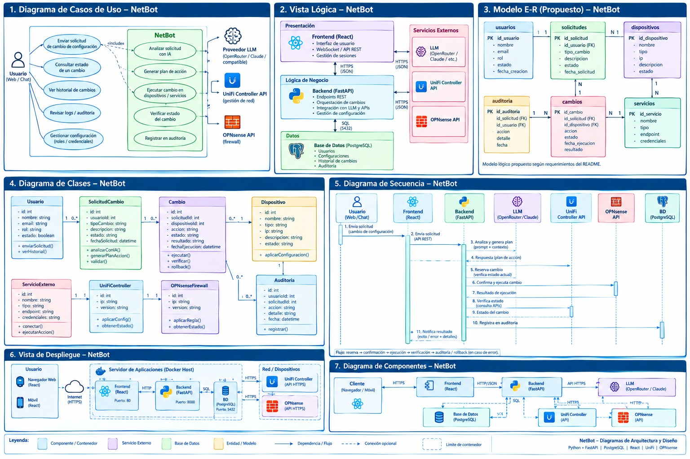
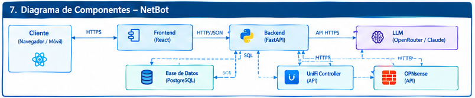
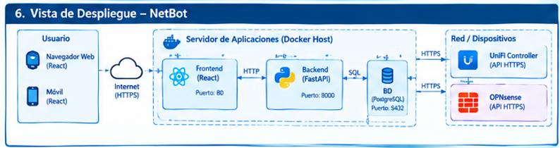
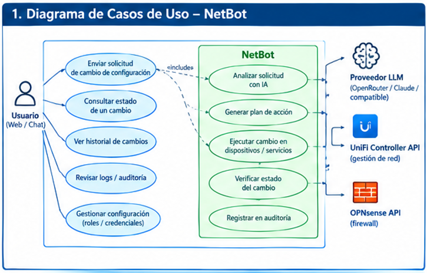
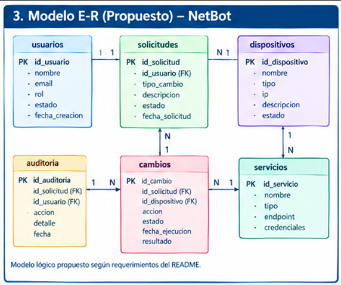
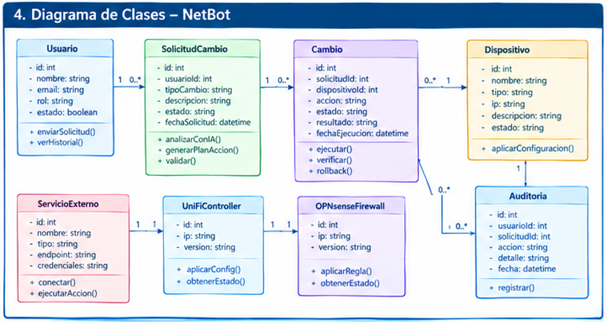
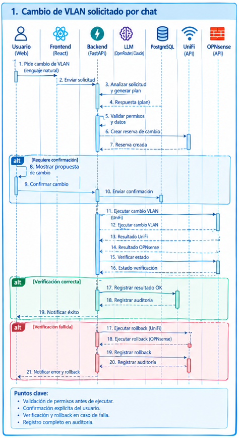
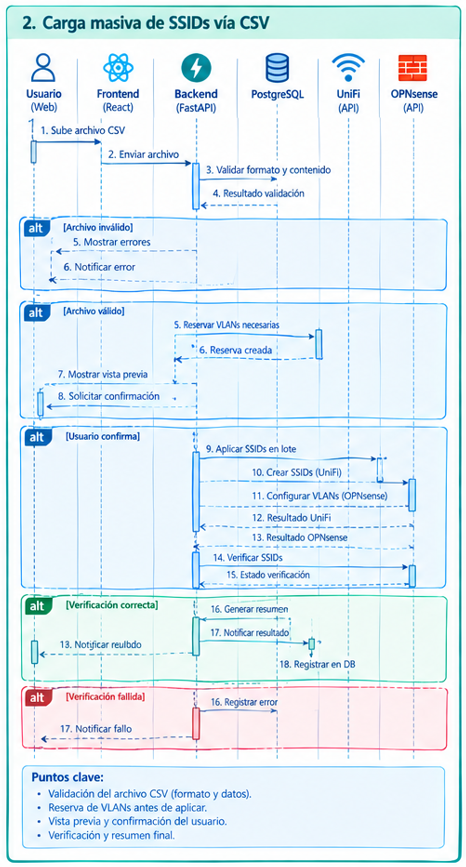
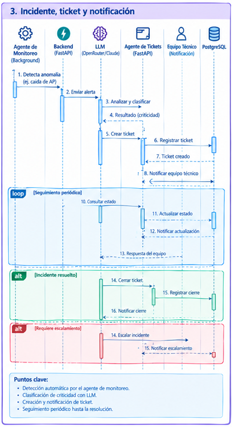

# Arquitectura de NetBot

Este documento resume la arquitectura de software de **NetBot** a partir de los diagramas que están en esta carpeta, sacados de *Documento 05 – Documento de Diseño* y de la *Guía Fase 2 – Desarrollo de Proyecto*.

NetBot es un asistente que recibe solicitudes de cambio de configuración de red escritas en lenguaje natural (por web o por chat). Analiza cada solicitud con un LLM y genera un plan de acción. Luego ejecuta el plan sobre **UniFi Controller** y **OPNsense**, comprueba el resultado y registra todo en auditoría. Si algo falla, revierte el cambio (rollback).



---

## 1. Stack tecnológico

| Capa | Tecnología | Detalle |
|---|---|---|
| Frontend | **React** | Interfaz web y móvil, WebSocket y API REST, gestión de sesiones |
| Backend | **Python + FastAPI** | Endpoints REST, coordinación de cambios, integración con el LLM y las APIs externas |
| Base de datos | **PostgreSQL** | Usuarios, configuraciones, historial de cambios y auditoría |
| IA | **LLM vía OpenRouter / Claude** (o compatible) | Análisis de solicitudes, generación de planes, clasificación de incidentes |
| Red (Wi-Fi/switching) | **UniFi Controller API** (HTTPS) | Gestión de red: SSIDs, VLANs, APs |
| Firewall | **OPNsense API** (HTTPS) | Reglas de firewall y VLANs |
| Infraestructura | **Docker** | Todos los servicios en un mismo Docker Host |

---

## 2. Vista lógica (capas)

```
┌──────────────────────── Presentación ────────────────────────┐
│ Frontend (React): UI, WebSocket / API REST, sesiones          │
└──────────────────────────────┬───────────────────────────────┘
                               │ HTTPS (JSON)
┌──────────────────────── Lógica de Negocio ───────────────────┐      HTTPS (JSON)    ┌── Servicios Externos ──┐
│ Backend (FastAPI): endpoints REST, coordinación de cambios,  │ ◄──────────────────► │ LLM (OpenRouter/Claude) │
│ integración con LLM y APIs, gestión de configuración         │                      │ UniFi Controller API    │
└──────────────────────────────┬───────────────────────────────┘                      │ OPNsense API            │
                               │ SQL (5432)                                           └─────────────────────────┘
┌──────────────────────────── Datos ───────────────────────────┐
│ PostgreSQL: usuarios, configuraciones, historial, auditoría  │
└──────────────────────────────────────────────────────────────┘
```

---

## 3. Diagrama de componentes



| Origen | Destino | Protocolo |
|---|---|---|
| Cliente (navegador / móvil) | Frontend (React) | HTTPS |
| Frontend | Backend (FastAPI) | HTTP / JSON |
| Backend | LLM (OpenRouter / Claude) | API HTTPS |
| Backend | Base de datos (PostgreSQL) | SQL |
| Backend | UniFi Controller API | HTTPS |
| Backend | OPNsense API | HTTPS |

El **Backend** es el único componente que se comunica con la base de datos y con los servicios externos. El frontend nunca llama directamente al LLM, a UniFi ni a OPNsense.

---

## 4. Vista de despliegue



- **Usuario:** navegador web (React) o móvil (React) que entra por Internet (HTTPS).
- **Servidor de aplicaciones (Docker Host):**

  | Contenedor | Puerto |
  |---|---|
  | Frontend (React) | 80 |
  | Backend (FastAPI) | 8000 |
  | BD (PostgreSQL) | 5432 |

  El frontend se comunica con el backend por HTTP y el backend con la BD por SQL.
- **Red / Dispositivos:** UniFi Controller (API HTTPS) y OPNsense (API HTTPS), a los que se llega desde el Docker Host.

---

## 5. Casos de uso



**Actor:** Usuario (web / chat).

Casos de uso del usuario:
1. Enviar solicitud de cambio de configuración
2. Consultar estado de un cambio
3. Ver historial de cambios
4. Revisar logs / auditoría
5. Gestionar configuración (roles / credenciales)

Casos internos de NetBot (`«include»` desde *Enviar solicitud*):
- Analizar solicitud con IA, usando el **proveedor LLM**
- Generar plan de acción
- Ejecutar cambio en dispositivos / servicios, sobre **UniFi Controller API** y **OPNsense API**
- Verificar estado del cambio
- Registrar en auditoría

---

## 6. Modelo de datos (E-R propuesto)



| Tabla | Campos |
|---|---|
| `usuarios` | **id_usuario (PK)**, nombre, email, rol, estado, fecha_creacion |
| `solicitudes` | **id_solicitud (PK)**, id_usuario (FK), tipo_cambio, descripcion, estado, fecha_solicitud |
| `cambios` | **id_cambio (PK)**, id_solicitud (FK), id_dispositivo (FK), accion, estado, fecha_ejecucion, resultado |
| `dispositivos` | **id_dispositivo (PK)**, nombre, tipo, ip, descripcion, estado |
| `servicios` | **id_servicio (PK)**, nombre, tipo, endpoint, credenciales |
| `auditoria` | **id_auditoria (PK)**, id_solicitud (FK), id_usuario (FK), accion, detalle, fecha |

**Relaciones** (tal como aparecen en el diagrama):
- `usuarios` 1 — 1 `solicitudes` (en el diagrama de clases es **1 — 0..\***, que parece ser la relación correcta)
- `solicitudes` 1 — N `cambios`
- `dispositivos` 1 — N `solicitudes` / `cambios`
- `dispositivos` 1 — N `servicios`
- `cambios` N — 1 `servicios`
- `auditoria` 1 — N `cambios`

> El diagrama aclara que es un "modelo lógico propuesto según requerimientos del README", así que todavía no es el esquema definitivo.

---

## 7. Diagrama de clases



| Clase | Atributos | Métodos |
|---|---|---|
| `Usuario` | id, nombre, email, rol, estado: bool | `enviarSolicitud()`, `verHistorial()` |
| `SolicitudCambio` | id, usuarioId, tipoCambio, descripcion, estado, fechaSolicitud | `analizarConIA()`, `generarPlanAccion()`, `validar()` |
| `Cambio` | id, solicitudId, dispositivoId, accion, estado, resultado, fechaEjecucion | `ejecutar()`, `verificar()`, `rollback()` |
| `Dispositivo` | id, nombre, tipo, ip, descripcion, estado | `aplicarConfiguracion()` |
| `Auditoria` | id, usuarioId, solicitudId, accion, detalle, fecha | `registrar()` |
| `ServicioExterno` | id, nombre, tipo, endpoint, credenciales | `conectar()`, `ejecutarAccion()` |
| `UniFiController` | id, ip, version | `aplicarConfig()`, `obtenerEstado()` |
| `OPNsenseFirewall` | id, ip, version | `aplicarRegla()`, `obtenerEstado()` |

**Multiplicidades:**
- `Usuario` 1 → 0..* `SolicitudCambio`
- `SolicitudCambio` 1 → 0..* `Cambio`
- `Cambio` 0..* → 1 `Dispositivo`
- `Dispositivo` 1 → `Auditoria`; `Cambio` 0..* → 0..* `Auditoria`
- `ServicioExterno` 1 → 1 `UniFiController` 1 → 1 `OPNsenseFirewall`

> Sugerencia para la implementación: `UniFiController` y `OPNsenseFirewall` pueden ser subclases (o adaptadores) de `ServicioExterno` con una interfaz común (`conectar`, `aplicar…`, `obtenerEstado`). Así el `Cambio` se ejecuta igual sobre cualquier proveedor.

---

## 8. Flujos principales (secuencia)

Todos los flujos siguen el mismo patrón:

**reserva → confirmación → ejecución → verificación → auditoría → rollback (si falla)**

### 8.1 Flujo general (vista general, diagrama 5)
1. El usuario envía la solicitud al frontend.
2. El frontend la reenvía al backend (API REST).
3. El backend envía la solicitud al LLM (prompt + contexto), que devuelve un plan de acción.
4. El backend reserva el cambio (verificando el estado actual en UniFi).
5. El backend confirma y ejecuta el cambio (OPNsense / UniFi) y recibe el resultado.
6. El backend verifica el estado consultando las APIs.
7. El backend registra el resultado en auditoría (PostgreSQL).
8. El frontend notifica al usuario el resultado (éxito, error y detalles).

### 8.2 Cambio de VLAN solicitado por chat



1. El usuario pide un cambio de VLAN en lenguaje natural y el frontend lo envía al backend.
2. El backend pide al **LLM** que analice la solicitud y genere un plan.
3. El backend valida permisos y datos, y crea una **reserva de cambio**.
4. **alt – Requiere confirmación:** se muestra la propuesta al usuario y este confirma.
5. El backend ejecuta el cambio de VLAN en **UniFi** y en **OPNsense**, y luego verifica el estado.
6. **alt – Verificación correcta:** se registra el resultado OK y la auditoría, y se notifica el éxito.
7. **alt – Verificación fallida:** se ejecuta el **rollback en UniFi y OPNsense**, se registran el rollback y la auditoría, y se notifica el error y el rollback.

**Puntos clave:** validar permisos antes de ejecutar, pedir confirmación explícita, verificar y hacer rollback si falla, y registrar todo en auditoría.

### 8.3 Carga masiva de SSIDs vía CSV



1. El usuario sube un archivo CSV y el frontend lo envía al backend.
2. El backend valida el formato y el contenido.
3. **alt – Archivo inválido:** se muestran los errores y se notifica.
4. **alt – Archivo válido:** se reservan las VLANs necesarias, se muestra una **vista previa** y se pide confirmación.
5. **alt – Usuario confirma:** se aplican los SSIDs en lote: se **crean los SSIDs en UniFi** y se **configuran las VLANs en OPNsense**. Después se verifican los SSIDs.
6. **alt – Verificación correcta:** se genera un resumen, se notifica el resultado y se registra en la BD.
7. **alt – Verificación fallida:** se registra el error y se notifica el fallo.

**Puntos clave:** validar el CSV (formato y datos), reservar las VLANs antes de aplicar, mostrar vista previa y pedir confirmación, y entregar verificación y resumen final.

### 8.4 Incidente, ticket y notificación



Participantes adicionales: **Agente de Monitoreo** (proceso en segundo plano), **Agente de Tickets** (FastAPI) y **Equipo Técnico** (recibe las notificaciones).

1. El agente de monitoreo detecta una anomalía (por ejemplo, la caída de un AP) y envía una alerta al backend.
2. El backend pide al **LLM** que analice y clasifique la alerta según su **criticidad**.
3. Se crea un ticket, que el agente de tickets registra en PostgreSQL, y se notifica al equipo técnico.
4. **loop – Seguimiento periódico:** se consulta el estado del ticket, se actualiza en la BD, se notifica la actualización y se recibe la respuesta del equipo.
5. **alt – Incidente resuelto:** se cierra el ticket, se registra el cierre y se notifica.
6. **alt – Requiere escalamiento:** se escala el incidente y se notifica el escalamiento.

**Puntos clave:** detección automática, clasificación de criticidad con el LLM, creación y notificación del ticket, y seguimiento periódico hasta la resolución.

> Este flujo añade dos componentes que **no aparecen** en los diagramas de componentes, despliegue, clases ni E-R: el agente de monitoreo y el agente de tickets. Tampoco hay una tabla `tickets` en el modelo de datos. Hay que agregarlos si este flujo entra en el alcance.

---

## 9. Observaciones e inconsistencias detectadas

Conviene resolver estos puntos antes de implementar:

1. **Tickets e incidentes no están modelados.** Faltan la entidad o tabla `tickets` y los servicios *Agente de Monitoreo* y *Agente de Tickets* en las vistas de componentes y despliegue.
2. **Reservas sin persistencia.** Los flujos usan "reserva de cambio" y "reserva de VLANs", pero el E-R no tiene una tabla ni un estado para las reservas. Se podría resolver con un valor `reservado` en `cambios.estado` o con una tabla `reservas`.
3. **La cardinalidad usuarios–solicitudes no coincide.** En el E-R es 1:1 y en el diagrama de clases es 1:0..*. Lo correcto es **1:N**.
4. **Las credenciales se guardan en la BD** (`servicios.credenciales`). Deben ir cifradas o en un gestor de secretos o variables de entorno, nunca en texto plano.
5. **Algunas flechas apuntan al participante equivocado.** En el flujo de VLAN, "Crear reserva de cambio" apunta a UniFi y "Enviar confirmación" apunta a PostgreSQL. En el flujo CSV, la numeración se repite (13, 16 y 17) y hay un error de tipeo ("reulbdo"). Son detalles de los diagramas y no afectan la arquitectura.
6. **No hay HTTPS en el contenedor del frontend.** El despliegue expone el frontend en el puerto 80. En producción hace falta TLS, por ejemplo con un reverse proxy como Nginx o Traefik delante.
7. **Falta definir la autenticación.** Existe "gestionar roles / credenciales", pero ningún diagrama dice cómo se autentica el usuario (JWT, sesiones, SSO).

---

## 10. Índice de imágenes

| Archivo | Contenido |
|---|---|
| `2_4_GuiaEstudiante_Fase_2_DesarrolloProyecto_APT_image3.png` | Lámina completa: casos de uso, vista lógica, E-R, clases, secuencia, despliegue y componentes |
| `Documento_05_-_Documento_de_Diseño_image3.png` | Secuencia: carga masiva de SSIDs vía CSV |
| `Documento_05_-_Documento_de_Diseño_image4.png` | Secuencia: cambio de VLAN solicitado por chat |
| `Documento_05_-_Documento_de_Diseño_image5.png` | Secuencia: incidente, ticket y notificación |
| `Documento_05_-_Documento_de_Diseño_image6.png` | Diagrama de componentes |
| `Documento_05_-_Documento_de_Diseño_image7.png` | Vista de despliegue |
| `Documento_05_-_Documento_de_Diseño_image8.png` | Diagrama de casos de uso |
| `Documento_05_-_Documento_de_Diseño_image9.png` | Modelo E-R propuesto |
| `Documento_05_-_Documento_de_Diseño_image10.png` | Diagrama de clases |
