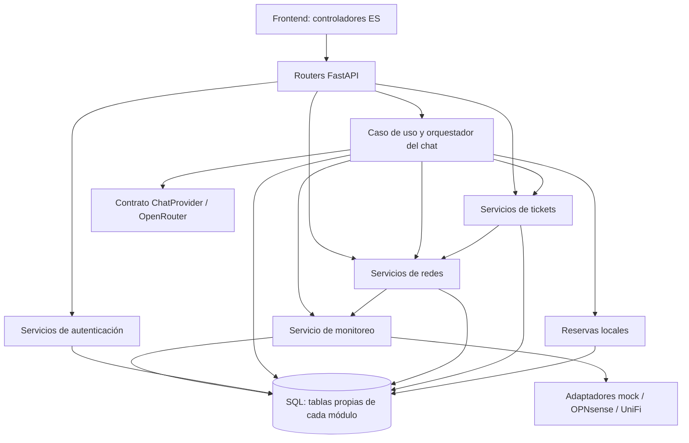
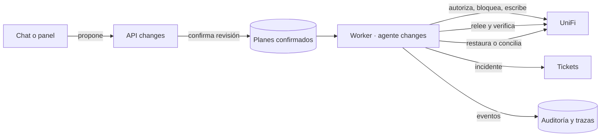

# Arquitectura modular vigente

La entrada pública incluye [autoatención de invitados y QR Wi-Fi](atencion-invitados.md). `chat/guest.py` posee sesiones en memoria con tokens aleatorios e historial del servidor; `guest_router.py` es una frontera HTTP pública separada. No acepta historial ni identidad del navegador y no ofrece herramientas al modelo. El ciclo de vida elimina sesiones vencidas cada segundo y al apagar la instancia. `networks/recipients.py` posee el registro y comparación de destinatarios sin cuenta. La recuperación de expositores verifica posesión mediante enlace de correo de un uso y expiración; el registro de destinatarios por sí solo no concede acceso al QR. `networks/email_recovery.py` posee tokens y revalidación de finalidad/asignación. Administración, Marketing y Servicios quedan excluidas. El QR se muestra en el dispositivo que confirma, fuera del tótem y del LLM. `networks/guest_access.py` solo publica anónimamente redes abiertas de `GUEST_WIFI_NETWORK_IDS`; `wifi_qr.py` genera el QR localmente. `frontend/modules/guest.mjs` controla resolución, confirmación y limpieza tras 60 segundos sin actividad, sin persistencia del navegador.

Esta guía describe el código implementado. Es el punto de entrada técnico junto con [AGENTS.md](../../AGENTS.md). El [documento de referencia](../../Arquitectura/LEEME_PRIMERO_ARQUITECTURA.md) conserva el diseño objetivo, separado del estado real.

Para continuar las integraciones se dispone de una [síntesis técnica de Atlas](contexto-desarrollo.md#contexto), con [contratos observados](contexto-desarrollo.md#integraciones), [decisiones propias](contexto-desarrollo.md#continuidad) y [evidencia](contexto-desarrollo.md#evidencias). No introduce dependencias hacia el producto del cliente ni cambia el stack. El bloque SSID/AP trabaja con **VLAN existentes**. La creación de SSID, el cambio de VLAN (HU010) y el reinicio de equipos (HU011) tienen propuesta, confirmación, worker, verificación y recuperación; todos están pendientes de validación física. Ver [cambios controlados y agentes](#cambios-controlados-y-agentes).

## Organización

Netbot es un monolito modular: una API FastAPI, una base SQL compartida y un frontend estático con módulos ES. Cada funcionalidad tiene propietario y una API interna. Compartir base de datos no autoriza a consultar tablas de otro módulo.

## Responsabilidades y entradas públicas

| Módulo | Propiedad y contratos |
|---|---|
| audit | Consulta global de metadatos mediante proyecciones públicas de auth, networks, tickets y changes; filtros, paginación y CSV. Solo `audit:read` (admin). No posee tablas ni consulta modelos de otros dominios. |
| auth | Usuarios/roles/tokens. `service.py` contiene login y administración; `access.py` autoriza actores; `dependencies.py` adapta identidad/permisos a HTTP. |
| networks | Inventario y asignaciones (`service.py`); autorización por recurso (`access.py`); configuración (`configuration.py`); claves (`credentials.py`); diagnóstico (`diagnostics.py`); registro de auditoría (`audit.py`). |
| tickets | Tablas Ticket/Event/Notification y ciclo de vida. `service.py` expone creación, actualización, detalle, listados y resúmenes del chat con autorización; `criticality.py` las reglas; `notifications.py` las entregas; `agent.py` el agente en memoria de incidentes, escalamiento y correo. |
| monitoring | Contratos `InfrastructureSource` y `NetworkMonitoringProvider`, normalización, servicio/cache/historial, fábrica de adaptadores mock/OPNsense/UniFi, inventario persistido y colector (`inventory.py`), alertas (`alerts.py`) y planos (`plans.py`). Tablas `monitoring_*`, migración 007. |
| chat | `application.py` coordina el mensaje; `service.py` orquesta herramientas/LLM; `storage.py` posee conversaciones e historial; `support.py` adapta servicios públicos a herramientas. |
| changes | Reservas VLAN (vencimiento y asignación), cargas CSV privadas, planes de creación SSID y cambio de VLAN (`ssid_service.py`), reinicios (`restart_service.py`), escritor UniFi (`ssid_executor.py`), conciliación (`reconciliation.py`) y cola de trabajos (`queue.py`). No modifica OPNsense. Validación física pendiente. |
| agents | Orquestador y estado de agentes (`orchestrator.py`), contrato de eventos y trazas (`events.py`), puente de incidentes hacia tickets (`incidents.py`) y worker de cambios (`worker.py`, `cli.py`). Tablas `agent_events` y `agent_states`. |
| core | Configuración, conexión SQL y errores de aplicación. No coordina dominios. |

Los routers del propio módulo pueden tipar User como identidad de sesión y delegar en su servicio. Entre dominios se intercambian IDs, schemas o diccionarios de contrato. `auth.models.User` es una excepción explícita a la regla de no importar modelos ajenos; no debe ampliarse.

El chat consulta `tickets.service.list_ticket_summaries()`; no importa Ticket ni consulta su tabla. Las consultas de redes que salen del módulo usan IDs o DTOs autorizados. Las claves nunca forman parte de esos DTOs.

## Dependencias permitidas

- auth → core.
- monitoring → core y autenticación de sus endpoints.
- networks → auth/core/monitoring.
- tickets → auth/core y APIs públicas de networks y monitoring.
- changes → auth/core/monitoring.
- chat → contratos y servicios públicos de auth/networks/tickets/changes/monitoring.
- agents → auth/core y servicios públicos de changes, tickets y monitoring. Ningún otro dominio importa agents (salvo el alias de entrada `changes/cli.py`): changes recibe el puerto de incidentes por inyección. `tests/test_architecture.py` lo comprueba.
- Composición → todos los módulos. Ningún dominio depende del punto de entrada HTTP.

La CLI de auth usa `bootstrap`, como adaptador de entrada independiente. Las importaciones de modelos para registrar metadata están centralizadas en `model_registry.py`, fuera de los dominios.

No se introduce una capa genérica de repositorios por obligación: SQLAlchemy permanece dentro del módulo propietario. Añadir una interfaz cuando exista una necesidad concreta de sustituir infraestructura; no duplicar cada método de Session.

## HTTP, casos de uso y transacciones

Los routers validan contratos HTTP, obtienen el actor autenticado e inyectan dependencias. Delegan reglas, consultas y escrituras a sus servicios. Los servicios públicos de administración y autorización pueden usarse desde otro adaptador sin depender de FastAPI y vuelven a comprobar los permisos del actor.

Los errores públicos (`NotFound`, `AccessDenied`, `Conflict`, etc.) se definen en `core/errors.py`. `http_errors.py` los convierte a los códigos HTTP existentes y conserva la forma `{"detail": "..."}`. Errores específicos del proveedor de chat se traducen en su router. No lanzar HTTPException desde servicios de negocio.

Cada operación de escritura tiene un dueño de transacción. Usuarios, inventario, configuración y tickets confirman en sus casos de uso. `chat.application.answer_message()` controla el intercambio; `storage.persist_exchange()` reautoriza, comprueba versión y guarda pregunta/respuesta juntas. Los helpers de auditoría agregan registros a la sesión, sin confirmar por separado.

Las herramientas de chat solo consultan o preparan propuestas. No llamar una operación que haga commit dentro del bucle del LLM. La creación del ticket o reserva ocurre por una solicitud API explícita; así un fallo del proveedor o conflicto de conversación no deja una escritura oculta.

Los schemas de respuesta conservan los contratos públicos. La refactorización modular no cambió tablas. La funcionalidad CSV posterior agrega `CsvImport` mediante la migración 005; su confirmación posee la transacción del lote completo. Ver [contrato CSV](carga-csv.md).

## Composición y ciclo de vida

- `main.create_app()` construye HTTP y registra adaptadores; no consulta la base ni crea tablas al importar.
- `routes.py` registra routers; `http_errors.py` registra la traducción de errores.
- `lifecycle.py` construye el orquestador y le registra los agentes del proceso web (monitoreo, tickets y limpieza periódica); inicia y cierra además el muestreo de tráfico y la expiración de invitados.
- `bootstrap.initialize_database()` registra metadata y prepara roles/admin; la CLI lo usa sin cargar FastAPI.
- `model_registry.register_models()` registra modelos para bootstrap y Alembic.

Con `ENVIRONMENT=development` o `test`, el bootstrap permite create_all como ayuda local. Los demás entornos exigen que las revisiones en alembic_version coincidan con las cabezas de las migraciones, antes de preparar roles/admin. No se ejecutan migraciones automáticamente en el arranque.

Para un despliegue: detener API y todos los workers → `alembic upgrade head` → arrancar los procesos con la misma versión. Las bases antiguas creadas con create_all requieren conciliar su esquema y registro de Alembic antes de aplicar migraciones; no ocultar discrepancias con stamp ni borrar datos como solución automática.

## Frontend modular

`app.js` únicamente crea y arranca `modules/dashboard.mjs`. El compositor inyecta dependencias y coordina el cambio de sesión; no contiene reglas del negocio de red.

| Archivo en modules/ | Responsabilidad |
|---|---|
| api.mjs | HTTP, tokens, una renovación compartida y rechazo de respuestas de otra época de sesión. |
| session.mjs | Login/logout/perfil; notifica autenticación y salida al compositor. |
| chat.mjs | Conversación, versión, selección, historial y mensajes. |
| monitoring.mjs | Estado privado de métricas, polling y representación del dashboard. |
| inventory.mjs | Resumen, dispositivos, alertas, SSID/VLAN y planos de cobertura. |
| support.mjs | Diagnóstico personal y panel temporal de acceso Wi-Fi. |
| tickets.mjs | Formulario, confirmación, filtros, listado y seguimiento de tickets. |
| notifications.mjs | Bandeja de notificaciones del equipo técnico. |
| reservations.mjs | Propuestas, confirmación y liberación de reservas locales. |
| csv-imports.mjs | Archivo, vista previa, selección, recuperación y confirmación explícita de reservas por CSV. |
| change-plans.mjs | Cambio de VLAN y reinicio: propuesta, impacto, confirmación, seguimiento y conciliación administrativa. |
| users.mjs / account.mjs | Administración de usuarios y roles; cambio de la contraseña propia. |
| system-status.mjs | Estado de los agentes y del proveedor de IA. |
| dom.mjs / format.mjs | Utilidades de vista y formato, sin reglas de permisos. |

Solo identidad y época de sesión se comparten. Cada controlador conserva su estado; callbacks explícitos conectan acciones del chat con soporte, tickets o reservas. No importar dashboard desde una funcionalidad ni agregar variables globales para comunicar módulos.

Las decisiones visuales no sustituyen autorización del backend. Los resultados tardíos se descartan al cambiar cuenta/selección. El acceso Wi-Fi se limpia al cambiar contexto, cerrar sesión o cumplirse un minuto, y no se guarda en el chat ni localStorage.

## Cómo ampliar una funcionalidad

1. Identificar el módulo dueño de los datos y el caso de uso; actualizar su contrato antes de conectar una nueva entrada.
2. Validar actor, permiso y recurso en el backend, incluidos usos fuera de HTTP.
3. Mantener SQL en el módulo propietario. Para colaboración usar su servicio público y resultados mínimos.
4. Si se integra infraestructura externa, definir contrato/adaptador y una implementación de pruebas. `ChatProvider` permite sustituir el LLM; monitoreo ya tiene su contrato de proveedor.
5. Definir errores públicos y el dueño del commit. Conservar versión/idempotencia y reautorizar tras esperas externas.
6. Agregar ruta/herramienta/vista como adaptadores. Una herramienta nueva debe declarar permiso y validar argumentos.
7. Ejecutar pruebas pertinentes, actualizar estas guías y los contratos funcionales afectados.

La lectura de UniFi ya tiene adaptador propio en `monitoring/providers/unifi`. Las operaciones de escritura AP/SSID/VLAN pasan por plan confirmado, trabajo durable, autorización al ejecutar, verificación, recuperación y auditoría; una operación nueva debe seguir ese mismo camino. Un proceso de muestreo en memoria no cumple ese contrato. Los roles delimitan capacidades; no es necesario crear un proceso/worker por cada rol.

## Verificación y alcance real

Desde netbot/: `.venv/bin/python -m pytest -q` y `node --test frontend/tests/*.test.mjs`.

`tests/test_architecture.py` impide dependencias hacia composición HTTP, FastAPI dentro de servicios, SQL/transacciones en routers e imports de tablas ajenas. También verifica CLI independiente y arranque de producción con esquema migrado. Los tests de frontend importan los módulos ES reales, con DOM/API inyectados; incluyen aislamiento entre dos instancias y representación de monitoreo.

Estas pruebas no sustituyen revisión visual de cambios de diseño ni validación contra hardware real.

Implementado: autenticación, aislamiento y persistencia de chat, reservas, monitoreo OPNsense/UniFi/mock de solo lectura con inventario, alertas y planos, acceso Wi-Fi protegido, tickets internos y por incidente, notificaciones, cambios controlados (creación SSID, cambio de VLAN, reinicio) con worker durable, verificación y recuperación, orquestador de agentes, proveedor LLM seleccionable y despliegue en contenedores. **Nada de lo que toca la red está validado contra equipos reales.** Pendiente: validación de laboratorio, MFA, edición de SSID en lote, retención de datos y administración de usuarios por chat. Frontend React y WebSocket pertenecen al diseño objetivo; `docker-compose.prod.yml` levanta proxy, API, worker y PostgreSQL.

## Integración vigente de monitoreo y tickets (02-11-2026)

El inventario, alertas, disponibilidad y planos se implementan en `monitoring.inventory`, `alerts`, `plans`, `models` y el paquete `providers.unifi`. Los incidentes y notificaciones se coordinan en `tickets.agent` y `tickets.notifications`. Se conservan planes SSID y auditoría de autenticación; migración 010 une las dos historias sin cambiar migraciones anteriores. Ver [decisiones de integración](contexto-desarrollo.md#integración-con-itamar--02-11-2026).

`providers.access_points.AccessPointAdapter` reutiliza el inventario normalizado UniFi para DTO mínimos por red, con sitio resuelto y estado explícito. No recolecta estadísticas ni presume heartbeat. `networks.telemetry` filtra por vinculación sitio/AP de la migración 009 y reautoriza tras las esperas. `MonitoringResponse.stale` identifica lecturas anteriores en la retención acotada; cambios y diagnósticos rechazan datos vencidos.

`frontend/modules/navigation.mjs` controla wrappers y hash; cada controlador mantiene su estado privado. Resumen contiene dashboard y chat; inventario, alertas, redes, planos y demás módulos tienen vistas independientes. `inventory.mjs` y `notifications.mjs` conservan sus contratos y reciben coordinación mediante callbacks del compositor.

## Auditoría unificada · HU013

`GET /api/v1/audit` permite filtrar por `actor_id`, `source` (auth, support, tickets, reservations, csv o ssid), `action` y `outcome` exactos, `since` y `until` inclusivos. Fechas ISO 8601 con zona horaria, normalizadas a UTC; la interfaz convierte desde/hacia hora local. Paginación `limit` entre 1 y 100, `offset` no negativo, orden estable por fecha y desempate por origen/ID/acción. La respuesta incluye `items`, `total`, `limit` y `offset`.

`GET /api/v1/audit/export` aplica los mismos filtros; CSV UTF-8 con BOM, sin paginación y con límite de 5000 filas. Si se supera, rechaza la solicitud para exigir filtros más acotados. Neutraliza fórmulas de hoja de cálculo y responde como descarga con `Cache-Control: no-store, private`. La pantalla usa el cliente autenticado compartido y descarta respuestas de otra sesión o consulta.

Cada módulo ofrece `audit_queries.py` con su proyección de metadatos. Se excluyen deliberadamente JSON de detalles, notas/evidencias de tickets, filas/resultados de CSV, secretos, contactos y conversaciones. `actor_id=null` significa sistema o identidad no determinada; no permite distinguir ambos sin datos históricos adicionales. El permiso `audit:read` pertenece solo a admin y también se comprueba desde el servicio sin HTTP. No requiere migración.

Reservas muestran creación/liberación; planes y cargas muestran creación/confirmación y una fila `snapshot=true` con su estado actual. La fecha de esa instantánea es la creación del plan: **no** acredita cuándo se ejecutó. La ejecución sí queda como evento inmutable en la proyección `auth` (ver la sección siguiente). `GET /api/v1/audit/mine` entrega a quien tiene `changes:request` únicamente sus propias acciones; el actor no se acepta desde la solicitud y la exportación sigue reservada a `audit:read`.

El chat de invitados devuelve un estado conversacional validado por el backend (`needs_information`, `answered`, `closed`). El modelo no puede emitir cierre; una intención explícita del usuario activa la confirmación de limpieza en la interfaz. Los estados y el historial permanecen en memoria y caducan juntos. Ver el [flujo de atención](atencion-invitados.md).

## Cambios controlados y agentes

Vigente desde el 14-11-2026. Contrato funcional en [carga CSV y planes](carga-csv.md#ejecución-verificación-y-recuperación).

- **Dos procesos.** El web propone y registra aprobaciones; nunca escribe en la red ni recibe la clave de escritura. El worker (`python -m app.agents.cli --loop`) ejecuta. La cola es la base: un reinicio no pierde aprobaciones y un trabajo interrumpido queda `executing` hasta conciliarse.
- **Propietario activo.** `changes.execution` excluye ejecución y conciliación por tipo/ID de plan. PostgreSQL usa un advisory lock de sesión en una conexión dedicada; requiere conexión directa o pooling de sesión, no pooling de transacción. SQLite local usa `flock` junto al archivo de la base en Unix; todos los procesos deben acceder a la misma base y directorio. La exclusión no vence por tiempo y sobrevive a los commits del servicio. La muerte del proceso libera esa exclusión, pero no el `WifiWriteLease` durable del recurso: primero debe conciliarse. `execution_started_at` determina la antigüedad de la ejecución; `confirmed_at` solo ordena aprobaciones. Estas son dos protecciones distintas y necesarias.
- **Cola.** Las aprobaciones vencidas pasan de `confirmed` a `expired` con auditoría antes de seleccionar el lote. Los rechazos definitivos previos a ejecutar pasan a `rejected`. `PlanBusy` conserva la aprobación y no genera un rechazo; errores transitorios conservan el trabajo vigente. Ninguna transición de rechazo o caducidad modifica un plan ya tomado.
- **Evidencia de reinicio.** Solo `ONLINE` después de un `OFFLINE` observado o un uptime menor acredita retorno. Un error de consulta o estado desconocido no prueba una caída. Sin evidencia, `uncertain` conserva el lease y abre incidente; la conciliación puede terminar como `unverified` si acredita disponibilidad, pero no el reinicio. El resultado y la auditoría conservan esa distinción.
- **Puerto de incidentes.** `changes` no importa `tickets`. Sus servicios reciben un puerto `(db, tipo, clave, mensaje)` que `agents.incidents` implementa sobre `tickets.agent.open_incident`. El ticket, la traza y el resultado del trabajo se confirman en la misma transacción.
- **Mantenimiento.** `monitoring.maintenance` es el contrato para declarar la caída esperada de un equipo; `alerts.device_conditions` la respeta. Lo usa el reinicio.
- **Orquestador.** `agents.orchestrator.Orchestrator` registra un ciclo por agente y lo ejecuta aislado: una excepción se registra, se reintenta en el ciclo siguiente y no detiene a los demás. Tres fallos seguidos abren un ticket `agent_failed`. El estado se persiste con un máximo de una escritura cada 10 s por agente sano.
- **Eventos.** `agents.events.Event` (versión 1): `event_id`, `correlation_id`, `agent_id`, `event_type`, `occurred_at`, recurso, resultado y detalle breve; sin secretos. Se deduplica por `event_id`. La correlación de un trabajo es `change:<tipo>:<id>`.
- **Herramientas del chat.** `get_scope_ssids`, `prepare_vlan_change`, `prepare_device_restart` y `get_access_points` consultan o validan; ninguna persiste, confirma ni ejecuta.
- **Proveedor LLM.** `chat.provider.ChatProvider` es el contrato; `build_provider()` elige `OpenRouterProvider` o `AnthropicProvider` según `LLM_PROVIDER`. Un adaptador nuevo implementa `complete()` y `health()`.

| Endpoint | Permiso | Uso |
|---|---|---|
| `GET /api/v1/agents/status` | `monitoring:read` | Última ejecución, errores y estado (`ok`, `failed`, `stalled`, `stopped`) de cada agente. |
| `GET /api/v1/agents/events` | `audit:read` | Trazas por agente o por correlación. |
| `GET /api/v1/chat/health` | `monitoring:read` | Conexión con el proveedor LLM configurado. |
| `GET /api/v1/audit/mine` | `changes:request` | Acciones propias. |
| `POST /api/v1/changes/reconcile/{tipo}/{id}` | `networks:manage` | Conciliación de solo lectura. |

Migraciones: `018_monitoring_maintenance`, `019_change_recovery`, `020_agent_events`, `021_execution_ownership`. La última agrega el inicio real de ejecución de los tres tipos de plan y el uptime previo del reinicio. Los `executing` heredados reciben la fecha de migración como inicio de gracia; el downgrade se rechaza si hay trabajos pendientes de conciliación. No se agregaron permisos: los existentes (`changes:request/approve/execute`, `networks:manage`) más el ámbito por recurso cubren estas operaciones sin cambiar la huella de autorización de las conversaciones.

Pruebas de exclusión con SQLite y PostgreSQL: `tests/test_change_execution_lock.py` usa sesiones, procesos separados y muerte del propietario. Para incluir PostgreSQL fuera de CI, definir `NETBOT_TEST_POSTGRES_URL` hacia una instancia desechable; las pruebas de migración crean y eliminan una base nueva de nombre aleatorio, por lo que ese usuario de pruebas requiere `CREATEDB`. No usar la conexión de producción. Sin esa variable los casos PostgreSQL se omiten; CI proporciona un PostgreSQL 16 aislado.

Límites conocidos: el orquestador vive en cada proceso (no hay bus entre procesos; se comunican por la base); las sesiones de invitados siguen exigiendo un solo worker web; no hay retención automática de trazas ni de auditoría.
