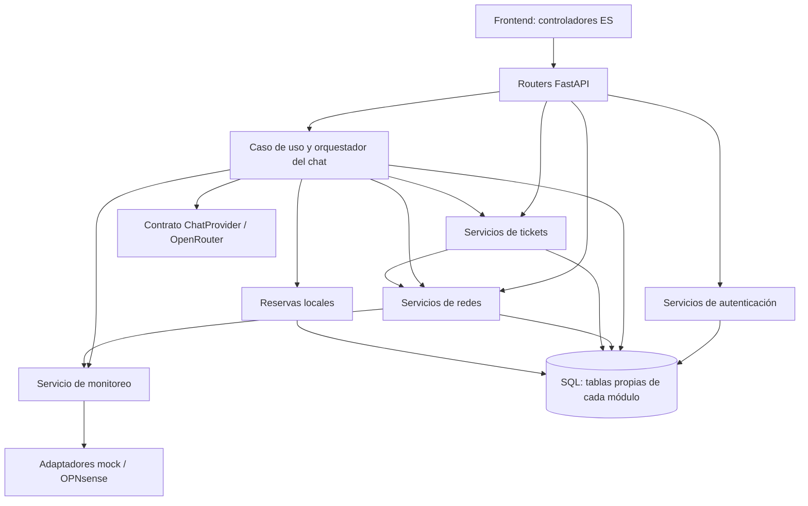

# Arquitectura modular vigente

Esta guía describe el código implementado. Es el punto de entrada técnico junto con [AGENTS.md](../../AGENTS.md). El [documento de referencia](../../Arquitectura/LEEME_PRIMERO_ARQUITECTURA.md) conserva el diseño objetivo, separado del estado real.

## Organización

Netbot es un monolito modular: una API FastAPI, una base SQL compartida y un frontend estático con módulos ES. Cada funcionalidad tiene propietario y una API interna. Compartir base de datos no autoriza a consultar tablas de otro módulo.

## Responsabilidades y entradas públicas

| Módulo | Propiedad y contratos |
|---|---|
| auth | Usuarios/roles/tokens. `service.py` contiene login y administración; `access.py` autoriza actores; `dependencies.py` adapta identidad/permisos a HTTP. |
| networks | Inventario y asignaciones (`service.py`); autorización por recurso (`access.py`); configuración (`configuration.py`); claves (`credentials.py`); diagnóstico (`diagnostics.py`); registro de auditoría (`audit.py`). |
| tickets | Tablas Ticket/Event y ciclo de vida. `service.py` expone creación, actualización, detalle, listados y resúmenes del chat con autorización. |
| monitoring | Contrato `NetworkMonitoringProvider`, normalización, servicio/cache/historial y fábrica de adaptadores mock/OPNsense. |
| chat | `application.py` coordina el mensaje; `service.py` orquesta herramientas/LLM; `storage.py` posee conversaciones e historial; `support.py` adapta servicios públicos a herramientas. |
| changes | Reservas VLAN locales confirmadas, liberación y cargas CSV privadas (`csv_parser.py`, `csv_service.py`). No ejecuta configuración de infraestructura. |
| agents | Reservado para trabajos futuros; no tiene workers operativos. |
| core | Configuración, conexión SQL y errores de aplicación. No coordina dominios. |

Los routers del propio módulo pueden tipar User como identidad de sesión y delegar en su servicio. Entre dominios se intercambian IDs, schemas o diccionarios de contrato. `auth.models.User` es una excepción explícita a la regla de no importar modelos ajenos; no debe ampliarse.

El chat consulta `tickets.service.list_ticket_summaries()`; no importa Ticket ni consulta su tabla. Las consultas de redes que salen del módulo usan IDs o DTOs autorizados. Las claves nunca forman parte de esos DTOs.

## Dependencias permitidas

- auth → core.
- monitoring → core y autenticación de sus endpoints.
- networks → auth/core/monitoring.
- tickets → auth/core y APIs públicas de networks.
- changes → auth/core/monitoring.
- chat → contratos y servicios públicos de auth/networks/tickets/changes/monitoring.
- Composición → todos los módulos. Ningún dominio depende del punto de entrada HTTP.

La CLI de auth usa `bootstrap`, como adaptador de entrada independiente. Las importaciones de modelos para registrar metadata están centralizadas en `model_registry.py`, fuera de los dominios.

No se introduce una capa genérica de repositorios por obligación: SQLAlchemy permanece dentro del módulo propietario. Añadir una interfaz cuando exista una necesidad concreta de sustituir infraestructura; no duplicar cada método de Session.

## HTTP, casos de uso y transacciones

Los routers validan contratos HTTP, obtienen el actor autenticado e inyectan dependencias. Delegan reglas, consultas y escrituras a sus servicios. Los servicios públicos de administración y autorización pueden usarse desde otro adaptador sin depender de FastAPI y vuelven a comprobar los permisos del actor.

Los errores públicos (`NotFound`, `AccessDenied`, `Conflict`, etc.) se definen en `core/errors.py`. `http_errors.py` los convierte a los códigos HTTP existentes y conserva la forma `{"detail": "..."}`. Errores específicos del proveedor de chat se traducen en su router. No lanzar HTTPException desde servicios de negocio.

Cada operación de escritura tiene un dueño de transacción. Usuarios, inventario, configuración y tickets confirman en sus casos de uso. `chat.application.answer_message()` controla el intercambio; `storage.persist_exchange()` reautoriza, comprueba versión y guarda pregunta/respuesta juntas. Los helpers de auditoría agregan registros a la sesión, sin confirmar por separado.

Las herramientas de chat solo consultan o preparan propuestas. No llamar una operación que haga commit dentro del bucle del LLM. La creación del ticket o reserva ocurre por una solicitud API explícita; así un fallo del proveedor o conflicto de conversación no deja una escritura oculta.

Los schemas de respuesta conservan los contratos públicos. La refactorización modular no cambió tablas. La funcionalidad CSV posterior agrega `CsvImport` mediante la migración 005; su confirmación posee la transacción del lote completo. Ver [contrato CSV](carga-csv.md).

## Composición y ciclo de vida

- `main.create_app()` construye HTTP y registra adaptadores; no consulta la base ni crea tablas al importar.
- `routes.py` registra routers; `http_errors.py` registra la traducción de errores.
- `lifecycle.py` inicia/cierra monitoreo y su tarea de muestreo en memoria.
- `bootstrap.initialize_database()` registra metadata y prepara roles/admin; la CLI lo usa sin cargar FastAPI.
- `model_registry.register_models()` registra modelos para bootstrap y Alembic.

Con `ENVIRONMENT=development` o `test`, el bootstrap permite create_all como ayuda local. Los demás entornos exigen que las revisiones en alembic_version coincidan con las cabezas de las migraciones, antes de preparar roles/admin. No se ejecutan migraciones automáticamente en el arranque.

Para un despliegue: detener backend → `alembic upgrade head` → arrancar. Las bases antiguas creadas con create_all requieren conciliar su esquema y registro de Alembic antes de aplicar migraciones; no ocultar discrepancias con stamp ni borrar datos como solución automática.

## Frontend modular

`app.js` únicamente crea y arranca `modules/dashboard.mjs`. El compositor inyecta dependencias y coordina el cambio de sesión; no contiene reglas del negocio de red.

| Archivo en modules/ | Responsabilidad |
|---|---|
| api.mjs | HTTP, tokens, una renovación compartida y rechazo de respuestas de otra época de sesión. |
| session.mjs | Login/logout/perfil; notifica autenticación y salida al compositor. |
| chat.mjs | Conversación, versión, selección, historial y mensajes. |
| monitoring.mjs | Estado privado de métricas, polling y representación del dashboard. |
| support.mjs | Diagnóstico personal y panel temporal de acceso Wi-Fi. |
| tickets.mjs | Formulario, confirmación, listado y seguimiento de tickets. |
| reservations.mjs | Propuestas, confirmación y liberación de reservas locales. |
| csv-imports.mjs | Archivo, vista previa, selección, recuperación y confirmación explícita de reservas por CSV. |
| dom.mjs / format.mjs | Utilidades de vista y formato, sin reglas de permisos. |

Solo identidad y época de sesión se comparten. Cada controlador conserva su estado; callbacks explícitos conectan acciones del chat con soporte, tickets o reservas. No importar dashboard desde una funcionalidad ni agregar variables globales para comunicar módulos.

Las decisiones visuales no sustituyen autorización del backend. Los resultados tardíos se descartan al cambiar cuenta/selección. El acceso Wi-Fi se limpia al cambiar contexto, cerrar sesión o cumplirse un minuto, y no se guarda en el chat ni localStorage.

## Cómo ampliar una funcionalidad

1. Identificar el módulo dueño de los datos y el caso de uso; actualizar su contrato antes de conectar una nueva entrada.
2. Validar actor, permiso y recurso en el backend, incluidos usos fuera de HTTP.
3. Mantener SQL en el módulo propietario. Para colaboración usar su servicio público y resultados mínimos.
4. Si se integra infraestructura externa, definir contrato/adaptador y una implementación de pruebas. `ChatProvider` permite sustituir el LLM; monitoreo ya tiene su contrato de proveedor.
5. Definir errores públicos y el dueño del commit. Conservar versión/idempotencia y reautorizar tras esperas externas.
6. Agregar ruta/herramienta/vista como adaptadores. Una herramienta nueva debe declarar permiso y validar argumentos.
7. Ejecutar pruebas pertinentes, actualizar estas guías y los contratos funcionales afectados.

UniFi debería tener un adaptador propio. Las operaciones AP/SSID/VLAN deben pasar por plan confirmado, trabajo durable, autorización al ejecutar, verificación y auditoría. Un proceso de muestreo en memoria no cumple ese contrato. Los roles delimitan capacidades; no es necesario crear un proceso/worker por cada rol.

## Verificación y alcance real

Desde netbot/: `.venv/bin/python -m pytest -q` y `node --test frontend/tests/*.test.mjs`.

`tests/test_architecture.py` impide dependencias hacia composición HTTP, FastAPI dentro de servicios, SQL/transacciones en routers e imports de tablas ajenas. También verifica CLI independiente y arranque de producción con esquema migrado. Los tests de frontend importan los módulos ES reales, con DOM/API inyectados; incluyen aislamiento entre dos instancias y representación de monitoreo.

Estas pruebas no sustituyen revisión visual de cambios de diseño ni validación contra hardware real.

Implementado: autenticación, aislamiento y persistencia de chat, reservas locales, monitoreo OPNsense/mock, acceso Wi-Fi protegido y tickets internos. Pendiente: UniFi, cambios reales de AP/SSID/VLAN, cola durable, verificación/compensación, administración por chat, aprovisionamiento CSV en UniFi y notificaciones externas. La validación CSV y reserva local están implementadas. Frontend React/WebSocket y contenedores API/frontend pertenecen al diseño objetivo; el Compose actual levanta PostgreSQL.
