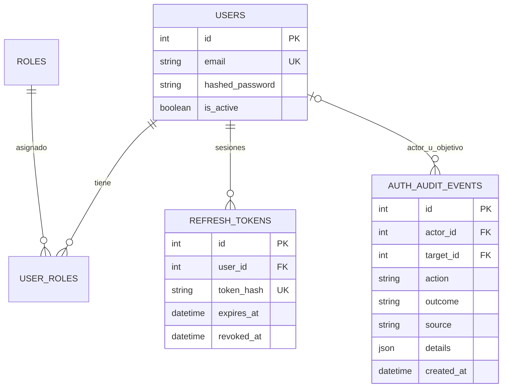
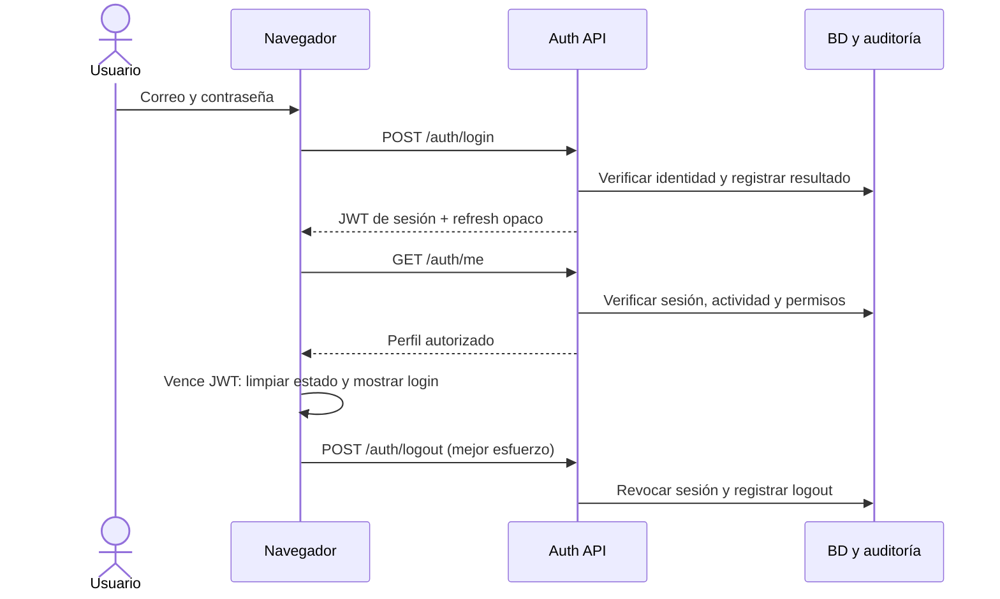

# Épica 001 · Autenticación y roles

Estado técnico revisado el 30-10-2026 en `feature/epica-001-auth-login`, a partir de `dev` (`d5de65a`). Alcance: HU001 (3 puntos), HU002 (5) y HU003 (5), **13 puntos candidatos a aceptación**. Esta guía no acredita aprobación de PR, publicación ni aceptación académica.

## Identidad y sesión

- Contraseñas Argon2; altas/cambios admiten 8–128 caracteres. La validación identifica campos sin reflejar contraseñas o tokens.
- `POST /auth/login` acepta `{email,password}`. Contraseña incorrecta, usuario desconocido o inactivo responden el mismo 401, sin indicar si el correo existe. Se registra cada intento con payload válido; errores de esquema son 422, no autenticaciones procesadas.
- JWT con caducidad y `sid`, vinculado a un refresh token opaco cuyo hash SHA-256 se guarda en BD. Se comprueban firma, vencimiento, sesión vigente, usuario activo y permisos actuales de BD. El claim `roles` no concede permisos.
- `POST /auth/refresh` rota atómicamente el refresh. El token anterior y su JWT quedan inválidos. Permanece para consumidores explícitos; el navegador **no renueva automáticamente** ni repite un POST tras un 401.
- Al vencer el acceso, incluso sin consultas o al volver de una pestaña suspendida, el navegador limpia los datos autenticados y muestra login. Intenta revocar el refresh por `/auth/logout`; el backend exige la caducidad del JWT igualmente.
- `POST /auth/logout` invalida el JWT de esa sesión inmediatamente y no cierra otras sesiones independientes. Si el backend no está accesible, la limpieza local no acredita revocación remota; sigue aplicándose la caducidad.
- Desactivar, reactivar, cambiar roles o contraseña revoca todas las sesiones previas. Reactivar no revive tokens antiguos.
- `GET /auth/me` devuelve perfil y permisos vigentes, nunca hashes. Respuestas auth/admin llevan `Cache-Control: no-store`.

`ACCESS_TOKEN_EXPIRE_MINUTES` es 30 por defecto; `REFRESH_TOKEN_EXPIRE_DAYS`, 7. Configurar secretos propios y HTTPS en producción. JWT anteriores sin `sid` requieren nuevo login tras desplegar esta versión.

## Administración

| Endpoint | Permiso | Comportamiento |
|---|---|---|
| `GET /admin/users` | `users:read` | Usuarios sin credenciales. |
| `POST /admin/users` | `users:manage` | Correo único, contraseña validada y roles existentes. |
| `PATCH /admin/users/{id}` | `users:manage` | Nombre, actividad, roles y contraseña; cambio atómico. |
| `GET/POST /admin/roles` | `roles:manage` | Consulta/alta de metadatos de rol. |
| `GET /admin/auth-audit?limit=50&offset=0` | `auth:audit:read` | Solo admin; máximo 100 eventos/página, orden descendente. |

No existe DELETE de usuarios ni auditoría. Se impide desactivar/degradar al último administrador activo. Mutaciones de identidad, login y refresh usan un bloqueo transaccional del registro del rol admin: protege carreras entre administradores y emisión frente a revocación de tokens. La CLI aplica el mismo guard. El primer usuario aprovisionado localmente debe ser admin.

Permisos iniciales en `auth/roles.py`. Un rol personalizado creado por API es metadato, sin permisos implícitos; no existe editor dinámico de permisos. La administración se ofrece por API/OpenAPI y CLI, no por un nuevo panel de usuarios.

## Matriz vigente

`operador` es alias funcional de `tecnico`; invitado es atención sin cuenta, no un rol autenticado.

| Capacidad | Admin | Técnico / operador | Visor | Cliente |
|---|---|---|---|---|
| Chat e historial propio | Sí | Sí | Sí | Sí |
| Usuarios, roles, asignaciones y auditoría de identidad | Sí | No | No | No |
| Monitoreo global | Sí | No | Sí | No |
| Redes de soporte | Todas | Asignadas, con detalles | Sin acceso implícito | Asignadas, datos mínimos |
| Credenciales / soporte | Autorizados | Redes asignadas | No | Propios / redes asignadas |
| Gestionar tickets | Global | Asignados | No | No |
| Reserva VLAN global | Sí | No | No | No |
| Preparar / aprobar planes SSID | Sí | Ámbitos concedidos | No | No |
| Ejecutar SSID | Ejecutor separado | Ejecutor separado, ámbito vigente | No | No |
| Reiniciar equipos | Sin operación implementada | Sin operación implementada | No | No |

La exclusión del técnico del monitoreo global y de la reserva VLAN global corresponde al alcance vigente de módulos 002/003 y debe resolverse contra sus propias historias. No se agregan capacidades de infraestructura para cerrar autenticación. Cuando exista reinicio, necesitará permiso específico y pruebas por tipo de equipo; el permiso genérico de cambios no autoriza reinicios críticos.

## Auditoría

La migración **008_auth_audit** crea `auth_audit_events`: actor/objetivo opcionales, acción, resultado, origen, detalles mínimos y fecha. Registra login correcto/incorrecto, refresh, logout, altas, cambios, actividad, roles, contraseña y denegaciones.

Los intentos fallidos usan una huella HMAC del identificador, sin guardar el correo. No se registran contraseñas, tokens, cabeceras, cuerpos de chat/HTTP ni query strings. CLI y bootstrap se distinguen por origen y no se atribuyen a un usuario autenticado ficticio.

Los cambios y sus eventos se confirman en la misma transacción. Las denegaciones HTTP se acumulan por solicitud y se persisten por separado tras cerrar/revertir la transacción rechazada, antes de devolver la respuesta. Incluye herramientas denegadas aunque el chat pueda explicar la limitación. No confirma trabajo parcial por guardar auditoría; si falla ese registro devuelve 503. El helper de permisos llamado directamente fuera de HTTP solo deniega: un adaptador no HTTP debe poseer su transacción de auditoría si necesita registrar rechazos.

Triggers SQLite/PostgreSQL rechazan UPDATE/DELETE de auditoría; las FK y el trigger SQLite impiden borrar usuarios referenciados. Se rechazan modificaciones mediante ORM. Esta auditoría de identidad no sustituye la auditoría completa de infraestructura pendiente en HU013.





## Instalación y verificación

Detener backend → `alembic upgrade head` → arrancar. Producción no crea tablas ni aplica migraciones automáticamente. En development/test, create_all no modifica una base existente ni sustituye Alembic. Bases heredadas requieren conciliación, sin borrarlas ni hacer stamp a ciegas.

Primera alta local: `python -m app.auth.cli admin@example.com --role admin`. Sin contraseña posicional se solicita oculta. La CLI no carga FastAPI. `ADMIN_EMAIL`/`ADMIN_PASSWORD` permiten alta inicial auditada por bootstrap, solo si el correo no existe; no actualizan contraseñas existentes.

Desde `netbot/`:

```sh
.venv/bin/python -m pytest -q
node --test frontend/tests/*.test.mjs
```

Evidencias: `tests/test_auth_epic_closure.py`, `test_auth_api.py`, `test_admin_api.py`, `test_security.py`, `test_architecture.py`, `test_scoped_chat.py`; frontend `auth-session.test.mjs` y `chat-session.test.mjs`. La matriz automatizada recorre todos los controles HTTP de permiso declarados para los cinco roles.

El 30-10-2026 se verificó además PostgreSQL 16.15 temporal por socket privado: migraciones hasta 008, arranque de producción, carrera de dos administradores, revocación, triggers inmutables y retención. En navegador, con base ficticia: error genérico, ingreso al dashboard y vencimiento con retorno al login. No se usaron cuentas ni equipos del cliente.

## Revisión de cierre

| Historia | Criterio funcional cubierto | Pendiente de aceptación |
|---|---|---|
| HU001 · 3 pts | Login activo, error genérico, vencimiento y auditoría. | PR aprobado por un par y demo/acta del equipo. |
| HU002 · 5 pts | Alta/edición/desactivación, último admin, retención, revocación y errores por campo. | Revisión de pares y conformidad del Documento de Diseño con el esquema. |
| HU003 · 5 pts | Permisos por API/chat, auditoría de denegaciones y matriz HTTP. | Revisión de pares, trazabilidad de diagramas y aceptación del alcance de roles. |

No acreditar puntos aceptados ni cierre académico únicamente por pruebas automáticas. Publicación, PR aprobado por otro integrante y acta de aceptación deben comprobarse por separado.
