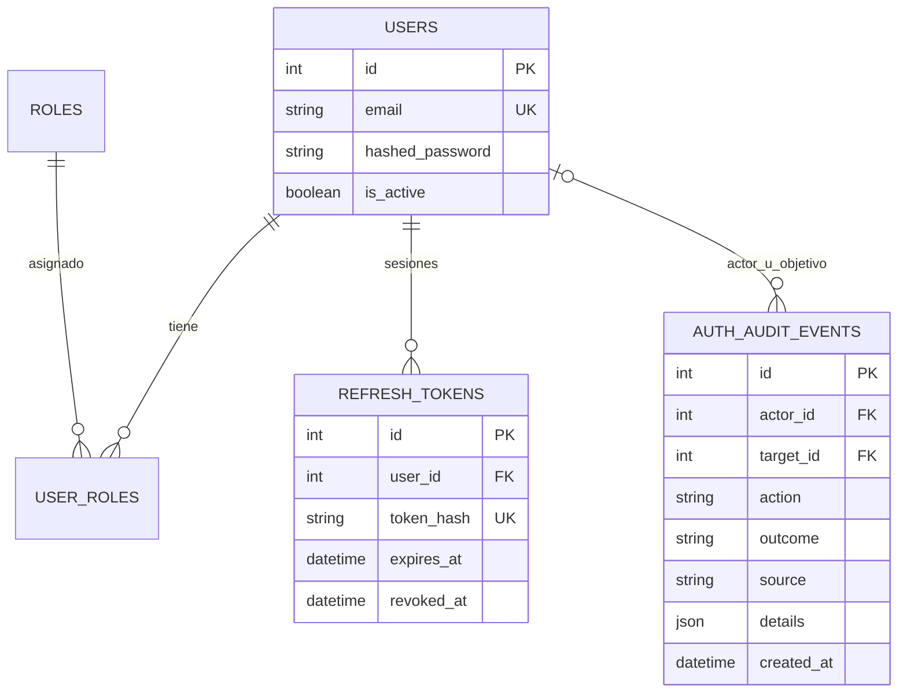
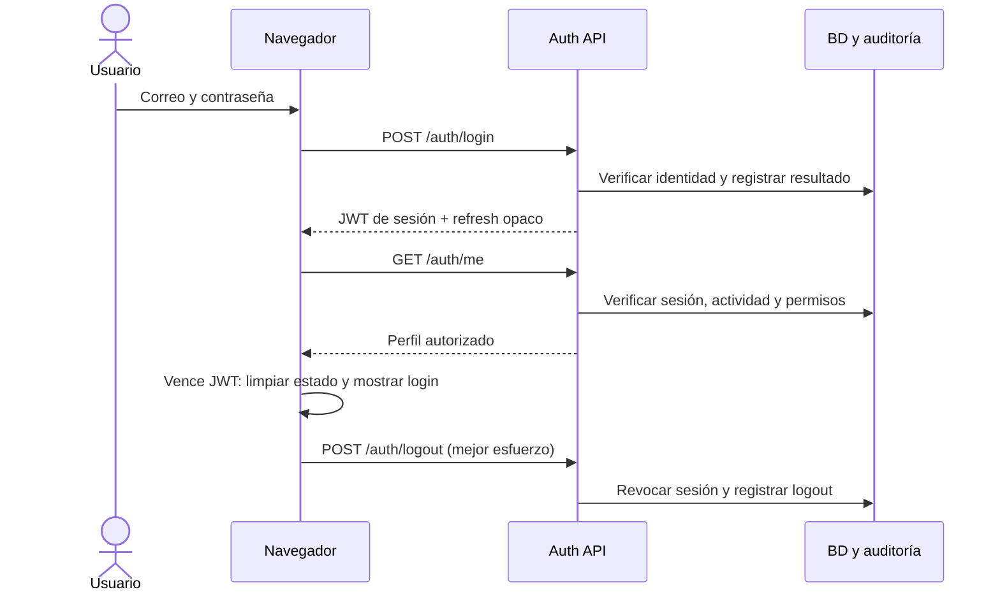

# Épica 001 · Autenticación y roles

Estado técnico revisado el 30-10-2026 en `feature/epica-001-auth-login`, a partir de `dev` (`d5de65a`). Alcance: HU001 (3 puntos), HU002 (5) y HU003 (5), **13 puntos candidatos a aceptación**. Esta guía no acredita aprobación de PR, publicación ni aceptación académica.

## Identidad y sesión

- Contraseñas Argon2; altas/cambios admiten 8–128 caracteres. La validación identifica campos sin reflejar contraseñas o tokens.
- `POST /auth/login` acepta `{email,password}`. Contraseña incorrecta, usuario desconocido o inactivo responden el mismo 401, sin indicar si el correo existe. Se registra cada intento con payload válido; errores de esquema son 422, no autenticaciones procesadas.
- JWT con caducidad y `sid`, vinculado a un refresh token opaco cuyo hash SHA-256 se guarda en BD. Se comprueban firma, vencimiento, sesión vigente, usuario activo y permisos actuales de BD. El claim `roles` no concede permisos.
- `POST /auth/refresh` rota atómicamente el refresh. El token anterior y su JWT quedan inválidos. Permanece para consumidores explícitos; el navegador **no renueva automáticamente** ni repite un POST tras un 401.
- Al vencer el acceso, incluso sin consultas o al volver de una pestaña suspendida, el navegador limpia los datos autenticados y muestra login. Intenta revocar el refresh por `/auth/logout`; el backend exige la caducidad del JWT igualmente.
- `POST /auth/logout` invalida el JWT de esa sesión inmediatamente y no cierra otras sesiones independientes. Si el backend no está accesible, la limpieza local no acredita revocación remota; sigue aplicándose la caducidad.
- Desactivar, reactivar, cambiar roles o contraseña revoca todas las sesiones previas. Reactivar no revive tokens antiguos.
- `GET /auth/me` devuelve perfil y permisos vigentes, nunca hashes. Respuestas auth/admin llevan `Cache-Control: no-store`.

`ACCESS_TOKEN_EXPIRE_MINUTES` es 30 por defecto; `REFRESH_TOKEN_EXPIRE_DAYS`, 7. Configurar secretos propios y HTTPS en producción. JWT anteriores sin `sid` requieren nuevo login tras desplegar esta versión.

## Administración

| Endpoint | Permiso | Comportamiento |
|---|---|---|
| `GET /admin/users` | `users:read` | Usuarios sin credenciales. |
| `POST /admin/users` | `users:manage` | Correo único, contraseña validada y roles existentes. |
| `PATCH /admin/users/{id}` | `users:manage` | Nombre, actividad, roles y contraseña; cambio atómico. |
| `GET/POST /admin/roles` | `roles:manage` | Consulta/alta de metadatos de rol. |
| `GET /admin/auth-audit?limit=50&offset=0` | `auth:audit:read` | Solo admin; máximo 100 eventos/página, orden descendente. |

No existe DELETE de usuarios ni auditoría. Se impide desactivar/degradar al último administrador activo. Mutaciones de identidad, login y refresh usan un bloqueo transaccional del registro del rol admin: protege carreras entre administradores y emisión frente a revocación de tokens. La CLI aplica el mismo guard. El primer usuario aprovisionado localmente debe ser admin.

Permisos iniciales en `auth/roles.py`. Un rol personalizado creado por API es metadato, sin permisos implícitos; no existe editor dinámico de permisos. La administración se ofrece por API/OpenAPI y CLI, no por un nuevo panel de usuarios.

## Matriz vigente

`operador` es alias funcional de `tecnico`; invitado es atención sin cuenta, no un rol autenticado.

| Capacidad | Admin | Técnico / operador | Visor | Cliente |
|---|---|---|---|---|
| Chat e historial propio | Sí | Sí | Sí | Sí |
| Usuarios, roles, asignaciones y auditoría de identidad | Sí | No | No | No |
| Monitoreo global | Sí | No | Sí | No |
| Redes de soporte | Todas | Asignadas, con detalles | Sin acceso implícito | Asignadas, datos mínimos |
| Credenciales / soporte | Autorizados | Redes asignadas | No | Propios / redes asignadas |
| Gestionar tickets | Global | Asignados | No | No |
| Reserva VLAN global | Sí | No | No | No |
| Preparar / aprobar planes SSID | Sí | Ámbitos concedidos | No | No |
| Ejecutar SSID | Ejecutor separado | Ejecutor separado, ámbito vigente | No | No |
| Proponer / aprobar reinicio | Cualquier equipo del sitio | Solo AP de sus ámbitos | No | No |
| Conciliar trabajos detenidos | Sí | No | No | No |
| Auditoría de acciones propias | Sí (completa) | Sí (`/audit/mine`) | No | No |

La exclusión del técnico del monitoreo global y de la reserva VLAN global corresponde al alcance vigente de módulos 002/003 y debe resolverse contra sus propias historias. No se agregan capacidades de infraestructura para cerrar autenticación. Cuando exista reinicio, necesitará permiso específico y pruebas por tipo de equipo; el permiso genérico de cambios no autoriza reinicios críticos.

## Auditoría

La migración **008_auth_audit** crea `auth_audit_events`: actor/objetivo opcionales, acción, resultado, origen, detalles mínimos y fecha. Registra login correcto/incorrecto, refresh, logout, altas, cambios, actividad, roles, contraseña y denegaciones.

Los intentos fallidos usan una huella HMAC del identificador, sin guardar el correo. No se registran contraseñas, tokens, cabeceras, cuerpos de chat/HTTP ni query strings. CLI y bootstrap se distinguen por origen y no se atribuyen a un usuario autenticado ficticio.

Los cambios y sus eventos se confirman en la misma transacción. Las denegaciones HTTP se acumulan por solicitud y se persisten por separado tras cerrar/revertir la transacción rechazada, antes de devolver la respuesta. Incluye herramientas denegadas aunque el chat pueda explicar la limitación. No confirma trabajo parcial por guardar auditoría; si falla ese registro devuelve 503. El helper de permisos llamado directamente fuera de HTTP solo deniega: un adaptador no HTTP debe poseer su transacción de auditoría si necesita registrar rechazos.

Triggers SQLite/PostgreSQL rechazan UPDATE/DELETE de auditoría; las FK y el trigger SQLite impiden borrar usuarios referenciados. Se rechazan modificaciones mediante ORM. Esta auditoría de identidad no sustituye la auditoría completa de infraestructura pendiente en HU013.





## Instalación y verificación

Detener backend → `alembic upgrade head` → arrancar. Producción no crea tablas ni aplica migraciones automáticamente. En development/test, create_all no modifica una base existente ni sustituye Alembic. Bases heredadas requieren conciliación, sin borrarlas ni hacer stamp a ciegas.

Primera alta local: `python -m app.auth.cli admin@example.com --role admin`. Sin contraseña posicional se solicita oculta. La CLI no carga FastAPI. `ADMIN_EMAIL`/`ADMIN_PASSWORD` permiten alta inicial auditada por bootstrap, solo si el correo no existe; no actualizan contraseñas existentes.

Desde `netbot/`:

```sh
.venv/bin/python -m pytest -q
node --test frontend/tests/*.test.mjs
```

Evidencias: `tests/test_auth_epic_closure.py`, `test_auth_api.py`, `test_admin_api.py`, `test_security.py`, `test_architecture.py`, `test_scoped_chat.py`; frontend `auth-session.test.mjs` y `chat-session.test.mjs`. La matriz automatizada recorre todos los controles HTTP de permiso declarados para los cinco roles.

El 30-10-2026 se verificó además PostgreSQL 16.15 temporal por socket privado: migraciones hasta 008, arranque de producción, carrera de dos administradores, revocación, triggers inmutables y retención. En navegador, con base ficticia: error genérico, ingreso al dashboard y vencimiento con retorno al login. No se usaron cuentas ni equipos del cliente.

## Revisión de cierre

| Historia | Criterio funcional cubierto | Pendiente de aceptación |
|---|---|---|
| HU001 · 3 pts | Login activo, error genérico, vencimiento y auditoría. | PR aprobado por un par y demo/acta del equipo. |
| HU002 · 5 pts | Alta/edición/desactivación, último admin, retención, revocación y errores por campo. | Revisión de pares y conformidad del Documento de Diseño con el esquema. |
| HU003 · 5 pts | Permisos por API/chat, auditoría de denegaciones y matriz HTTP. | Revisión de pares, trazabilidad de diagramas y aceptación del alcance de roles. |

No acreditar puntos aceptados ni cierre académico únicamente por pruebas automáticas. Publicación, PR aprobado por otro integrante y acta de aceptación deben comprobarse por separado.

## Bloqueo temporal de login HU001

Desde `feature/auth-login-lockout`, cinco contraseñas incorrectas consecutivas para una cuenta activa bloquean nuevos ingresos durante 15 minutos. Incluso una contraseña correcta se rechaza mientras el bloqueo esté vigente. Los intentos durante ese período no prolongan su duración ni generan nuevas sesiones. Al cumplirse el plazo, la siguiente solicitud inicia una secuencia nueva; un login exitoso reinicia el contador. El bloqueo temporal no cambia `is_active` ni habilita una cuenta desactivada y no revoca sesiones válidas anteriores.

La migración `011_login_lockout` agrega contador y vencimiento en `users`: el estado se comparte entre procesos y persiste al reiniciar el servicio. Aplicar `alembic upgrade head` antes del despliegue; `create_all` no actualiza bases existentes. Los intentos se serializan con el bloqueo transaccional de identidad existente para no perder incrementos concurrentes.

Se conserva la respuesta genérica HTTP 401 de credenciales inválidas para cuentas desconocidas, inactivas y temporalmente bloqueadas. No se publican contadores ni fechas de bloqueo en el perfil ni se guardan contraseñas en auditoría. Cada rechazo conserva `auth.login.failed`; la transición al bloqueo registra una sola vez `auth.login.locked` con la cuenta objetivo.

`tests/test_login_lockout.py` cubre el quinto fallo, contraseña correcta durante bloqueo, vencimiento exacto, reinicio de conteo, aislamiento por cuenta, cuentas inactivas, persistencia entre sesiones de base de datos y fallos concurrentes. Las pruebas de migración verifican datos existentes y defaults de las columnas nuevas. Esto completa el comportamiento de bloqueo del backlog; la aceptación de HU001 por el equipo y los demás criterios de entrega se revisan por separado.


## Remediación de auditoría y pantallas (14-11-2026)

- Contraseñas nuevas o cambiadas: mínimo 12 caracteres. `POST /auth/password` exige la contraseña vigente y cierra todas las sesiones; la interfaz lo ofrece en **Mi cuenta**.
- Bloqueo: el último origen con ingreso correcto conserva el acceso durante un bloqueo. `POST /admin/users/{id}/unlock` lo levanta; la vista **Usuarios** lo expone junto al alta, edición, roles y desactivación. Migración 015.
- Sesiones: reutilizar un refresh ya rotado cierra todas las sesiones de la cuenta (`auth.refresh.reuse_detected`) y `SESSION_ABSOLUTE_DAYS` limita su vida total. Migración 016.
- El reinicio no agregó un permiso: usa `changes:request/approve/execute` más el ámbito por recurso, y los equipos críticos o no clasificados exigen `networks:manage`. Agregar un permiso cambiaría la huella de autorización y ocultaría conversaciones existentes.
- MFA sigue pendiente de decisión (TOTP u OIDC).

## Acceso con Google Workspace (rama frontend React)

Disponible como opción desactivada por defecto. Un usuario de personal previamente creado en NetBot puede usar su cuenta corporativa de Google. El backend mantiene los roles y las redes asignadas; no crea cuentas ni concede permisos por pertenecer al dominio. Admite los roles `admin`, `tecnico`, `operador` y `visor`. Los clientes y la autoatención de invitados conservan sus flujos actuales.

### Configuración

1. Aplicar `alembic upgrade head` (migración `022_google_login`) antes de arrancar API y procesos de la misma versión.
2. Crear un cliente OAuth de tipo **Aplicación web** en Google Cloud. Registrar los **orígenes JavaScript autorizados**: en desarrollo, los orígenes que se usen realmente (`http://127.0.0.1:5173` y/o `http://localhost:5173`); en producción, el origen HTTPS exacto. Este flujo usa el callback JavaScript de Google Identity Services, sin callback de redirección en NetBot.
3. Completar en el entorno del backend `GOOGLE_CLIENT_ID` y `GOOGLE_ALLOWED_DOMAINS`, este último como lista JSON de dominios Workspace exactos, por ejemplo `["empresa.example"]`. Se comprueba `hd` y el dominio del correo verificado, sin comodines ni subdominios implícitos. Confirmar el dominio real antes de habilitarlo. Revisar además las políticas de aplicaciones de terceros de la organización Workspace.
4. Crear o revisar los usuarios corporativos autorizados en **Usuarios**, asignando sus roles y ámbito habituales. El modelo conserva una contraseña local como alternativa de acceso; el dominio por sí solo no habilita una cuenta nueva.
5. Definir `GOOGLE_LOGIN_ENABLED=true`, reiniciar la API y reconstruir el frontend/proxy si aún sirve la versión previa a esta implementación. El ID de cliente se obtiene del backend: no configurar secretos ni claves en variables `VITE_*`.

El ID de cliente es público. Este flujo de inicio de sesión no usa un client secret ni solicita acceso a Gmail o Drive. Se usa la biblioteca oficial `google-auth` para verificar firma, audiencia, emisor y tiempo del ID token. La API usa HTTPS con timeout acotado para consultar únicamente el endpoint fijo de certificados de Google. Una caída del proveedor rechaza el acceso Google y conserva el login local.

### Flujo y límites

- `GET /auth/google/config` publica únicamente si está habilitado y el ID de cliente público. La interfaz no carga el SDK cuando está desactivado.
- `POST /auth/google/challenge` emite un secreto y nonce aleatorios con vigencia de cinco minutos. La base almacena sus hashes. La respuesta y las demás rutas de autenticación tienen `Cache-Control: no-store`. Hay límites por origen y globales, además del límite de cuerpo.
- El botón oficial de Google recibe ese nonce. Su callback JavaScript envía JSON a `POST /auth/google`, con `credential` y `challenge_token`. No se aceptan roles, usuarios ni dominios elegidos por el navegador. El nonce firmado y el desafío de un solo uso vinculan la respuesta al intento de login; no hay autenticación por cookies ni procesamiento de formularios de redirección de terceros.
- El desafío se consume atómicamente antes de consultar las claves externas. Un intento fallido, vencido o repetido requiere uno nuevo. No se mantiene el bloqueo de usuarios durante la espera externa. Después se releen cuenta activa, roles y vinculación antes de emitir una sesión NetBot.
- En el primer acceso válido se vincula el identificador estable `sub` con la cuenta local de correo corporativo verificado. Después se exige la misma vinculación y el correo local correspondiente. Una cuenta Google diferente con un correo reciclado no reemplaza una vinculación existente. No hay desvinculación automática ni migración silenciosa entre cuentas.
- Los tokens Google no se guardan en la base, localStorage, auditoría o historial. La aplicación emite sus propios tokens, con la expiración, revocación y permisos habituales. Desactivar una cuenta o cambiar sus roles en NetBot revoca sus sesiones. Suspender una cuenta únicamente en Google no revoca por sí solo sesiones NetBot ya emitidas; estas conservan sus controles locales y duración vigente.
- Auditoría: `auth.google.linked`, `auth.google.succeeded` y `auth.google.failed`, sin credenciales ni contactos. Los errores no revelan si un correo está registrado.
- La CSP de frontend/nginx permite exclusivamente los recursos necesarios de Google Identity Services en `accounts.google.com/gsi/` para scripts, estilos, conexiones e iframe; no habilita `unsafe-eval` ni scripts inline en producción. Los demás permisos de red se conservan.

Las pruebas automatizadas usan cuentas ficticias, certificados RSA locales y transporte simulado. No acreditan configuración real de Google Cloud, aprobación de Workspace, MFA corporativo ni un login real con cuentas de Diktya. La prueba real requiere el cliente OAuth y el dominio autorizados. El downgrade de `022` se rechaza si existen identidades vinculadas para impedir que se pierda la protección por `sub`; conservarlas y respaldar antes de cualquier cambio de versión.

Fuentes de implementación: [verificación de ID token](https://developers.google.com/identity/gsi/web/guides/verify-google-id-token), [OpenID Connect](https://developers.google.com/identity/openid-connect/openid-connect) y [biblioteca oficial Python](https://google-auth.readthedocs.io/en/latest/reference/google.oauth2.id_token.html).

### Cuentas de clientes externos

En **Usuarios → Nuevo cliente**, un administrador registra el correo externo
y una contraseña temporal. El cliente entra mediante el formulario local y
puede cambiar su contraseña en **Mi cuenta**. Para darle acceso a una red,
el administrador debe asignársela mediante el flujo existente.

El formulario y `POST /admin/users/customers` no aceptan roles. El servidor
asigna el perfil interno fijo de cliente y rechaza reemplazarlo o combinarlo
con permisos internos, también desde la CLI. El administrador puede editar
el nombre, restablecer la contraseña, desbloquear o desactivar la cuenta.
